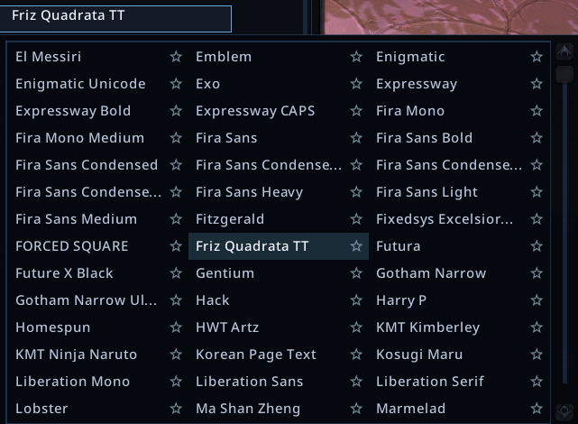
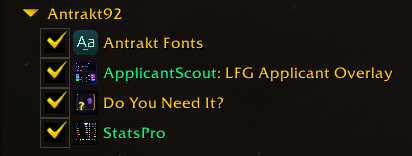

  

<h1 align="center">Antrakt Fonts</h1>

  46 fonts. One collection for your WoW addons.

  <a href="#installation">Installation</a>
  · <a href="#fonts">Fonts</a>
  · <a href="#questions-or-problems">Help</a>

46 fonts for World of Warcraft addons, shared through LibSharedMedia.
Install the collection once per game client, then choose a font in your addon's
settings. Each addon keeps its own font, size and profile.

The fonts used to be bundled with StatsPro and Do You Need It? Keeping them in
one package makes regular addon downloads smaller and lets other addons use
the same collection.

**Retail release awaiting approval. Forever build still in testing.**

  

*The collection in StatsPro. Fonts are selected in the addon that uses them.*

## Installation

The Retail build is being prepared for **Midnight**; the **WoW Forever beta**
build needs further testing. Download links will be added when each build is
available.

For a manual install:

1. Download the packaged ZIP for your client.
2. Extract its `AntraktFonts` folder into that client's `Interface/AddOns` folder.
3. Keep **Antrakt Fonts** enabled in the game's AddOns list, then choose a font
   in your addon's settings.

A newly installed addon may need a game restart to appear. GitHub source-code
ZIPs are not installable packages.

  

Upcoming CurseForge versions of StatsPro and Do You Need It? will list Antrakt
Fonts as a dependency, so the app can install the matching build for you. This
is not live yet. You can also install it manually. Both addons keep a readable
default font when the collection is missing.

Choose your font in the addon that uses it. Antrakt Fonts has no settings window
and does not change the game's fonts. It works without StatsPro or Do You Need
It? installed.

## Fonts

The collection includes DejaVu, Fira Sans, Hack, PT Sans, Source Han and more.
There are fonts for Latin, Cyrillic, Chinese, Japanese and Korean text, but
character support varies by font. Addons can use the included language metadata
to show suitable choices.

Both client builds use the same fonts and file paths, with different client
metadata. Font updates are separate from updates to the addons that use them.

## Questions or problems?

[Open an issue](https://github.com/Antrakt92/AntraktFonts/issues) if something
isn't working. If you'd like to use the collection in your own addon, see the
[examples](examples/README.md).

Thanks to [chenrylee](https://github.com/chenrylee) for the idea to move fonts
into a separate package ([StatsPro #10](https://github.com/Antrakt92/StatsPro/issues/10)).

Fonts and libraries keep their own licenses. See the
[credits and licenses](THIRD-PARTY-NOTICES.md) for details. The
[project license](LICENSE) covers the original code.

Development instructions are in [CONTRIBUTING.md](CONTRIBUTING.md); API details
are in [catalog/README.md](catalog/README.md).
